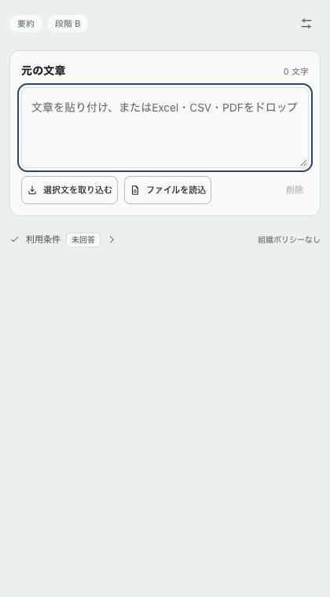
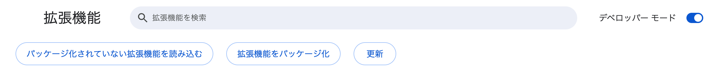
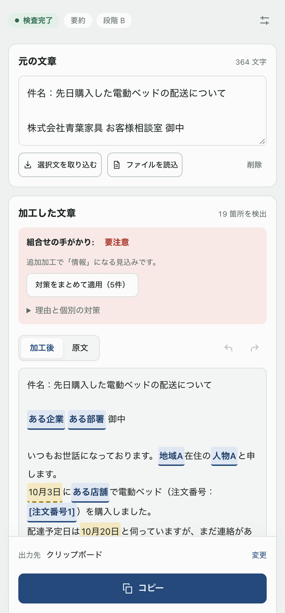
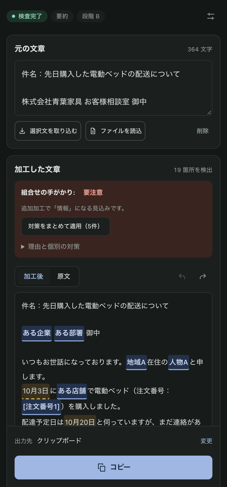
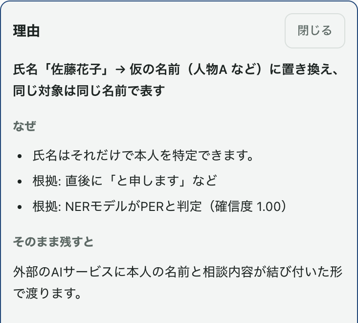
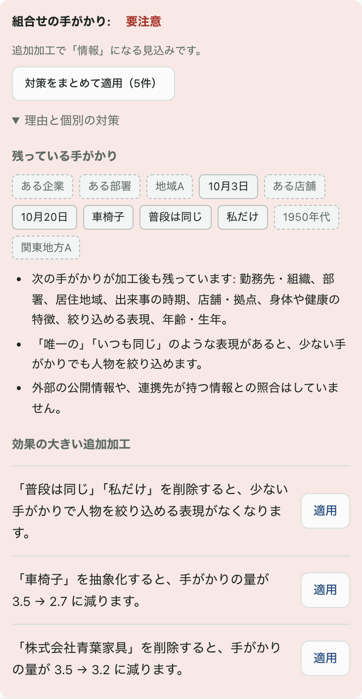
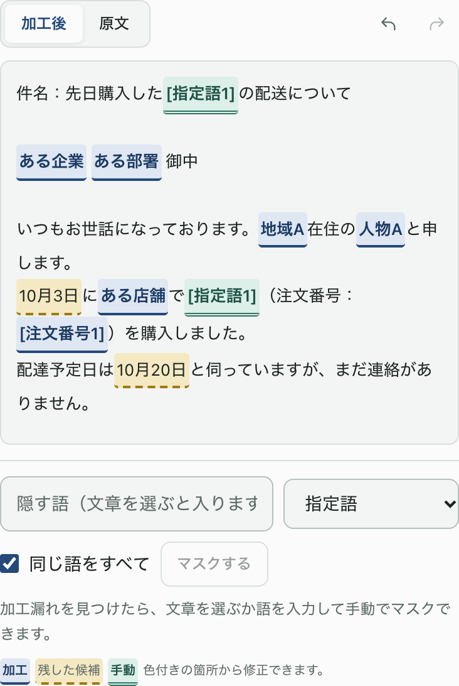
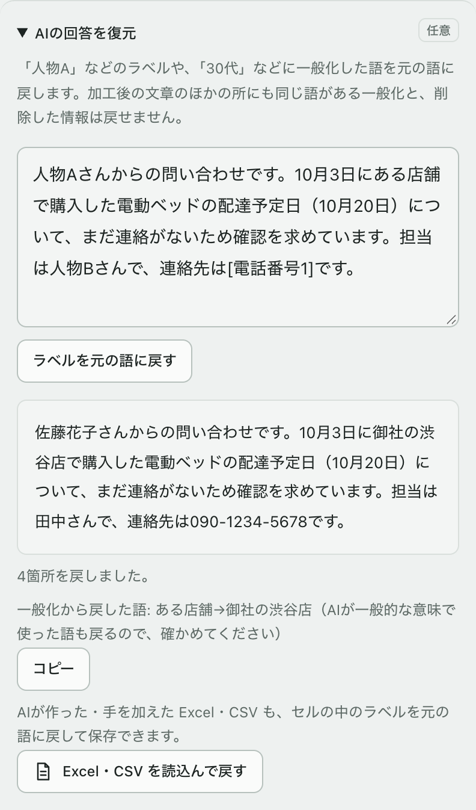

# テキストクリーナー

生成AIに貼る前の文章から、個人情報・機密情報を**端末の中だけで**見つけて置き換える Chrome 拡張です。

<p align="center">
  
</p>

## 使い方

### 1. ダウンロードする
[最新のリリース](https://github.com/jphacks/ok_2610/releases/latest) を開き、「Assets」にある `text-cleaner-<版>-chrome.zip`（約220MB）をダウンロードして展開します。
展開したフォルダに `manifest.json` が入っていれば準備完了です。

> Google Chrome 138 以降が必要です。人名などを見つける日本語モデルを同梱しているため、ファイルが大きくなっています。

### 2. Chrome に読み込む
1. アドレスバーに `chrome://extensions` と入力して開く
2. 右上の「**デベロッパー モード**」をオンにする
3. 「**パッケージ化されていない拡張機能を読み込む**」を押し、展開したフォルダを選ぶ
4. ツールバーのパズルのアイコンから「テキストクリーナー」をピン留めする



### 3. 使う
1. ツールバーのアイコンを押すと、サイドパネルが開きます。ページで文章を選んで右クリックし、「テキストクリーナーで解析」を選んでも開けます。
   - Excel・CSV・PDF は「ファイルを読込」か、入力欄へのドロップで取り込めます。PDF は、出力先で「PDF のまま保存（レイアウトを保つ）」を選ぶと、隠す語をラベルに置き換えた PDF を保存でき、AI から戻ってきた PDF も「AIの回答を復元」で元の語に戻せます（PDF の対応は v0.7.0 以降）。
   - 画像（PNG・JPEG・WebP・BMP）も取り込めます。中の文字を端末内の OCR で読んで検査し、出力先で「画像として保存（隠す語を塗りつぶす・PNG）」を選ぶと、隠す語を塗りつぶしてラベルを書いた画像を保存できます。画像の中の顔も端末内で見つけて塗りつぶします（顔ごとに残すこともできます）。AI から戻ってきた画像も「AIの回答を復元」で元の語に戻せます。PDF の中の画像の顔も同じように隠せます。
2. 文章を貼り付けると、約1秒で加工した文章が表示されます（初回だけ、モデルの読み込みに5秒ほどかかります）。
3. 色の付いた箇所を押すと、隠した理由が表示され、処理を変えられます。加工漏れは、文章を選ぶか語を入力して手動でマスクできます。
4. 「コピー」を押して AI に貼り付けます。AI の回答は「AIの回答を復元」に貼ると、「人物A」などを元の語に戻せます。

| 加工した文章（ライト） | ダークモード |
|---|---|
|  |  |

用途（要約・返信の下書きなど）や段階、残したい情報は、右上の設定ボタンから変えられます。

### 更新するとき
新しいリリースの zip を展開して前のフォルダの中身と入れ替え、`chrome://extensions` でテキストクリーナーの再読み込みボタン（↻）を押します。

### うまくいかないとき
| 症状 | 対処 |
|---|---|
| 「マニフェスト ファイルが見つからないか読み取れません」と出る | `manifest.json` が直接入っているフォルダを選んでください（その1つ上や下のフォルダではなく） |
| 検査の詳細に「NER: 使えません」と出る | zip の展開が途中で止まっている可能性があります。もう一度展開し、`models` フォルダがあることを確かめてください |
| PDF の画像の中の文字が隠れていない | 画像の中の文字は端末内の OCR で読むため、読み違えることがあります。「PDF の仕上がりを確認」でページを確かめ、ドラッグで手動で隠してください |
| 画像の中の文字が隠れていない | 画像の中の文字は端末内の OCR で読むため、読み違えることがあります。「画像の仕上がりを確認」で確かめ、ドラッグで手動で隠してください |
| 画像の中の顔が隠れていない | 横顔や小さな顔、一部が隠れた顔は見逃すことがあります。「画像の仕上がりを確認」で確かめ、ドラッグで手動で隠してください |
| PDF のまま保存できない | 縦書きの文字など置き換えられない文字を隠すとき、暗号化などで構造を読めない PDF のときは、PDF としては保存しません。保存できない理由が画面に表示されます（文章としてのコピーはできます） |
| 「Gemini Nano: この端末では使えません」と出る | Gemini Nano は補助なので、なくても動きます。Chrome の組込みモデルがダウンロードされると使えるようになります |

## 製品概要
### 背景(製品開発のきっかけ、課題等）
議事録・問い合わせ・面談記録などを生成AIで要約したいとき、作業者は「氏名を消せば十分か」「どの属性まで残してよいか」「会社のルールが明確でないときどう判断するか」で迷います。
生年月日と業務上の日付を一律に隠すと要約の意味が失われる一方、勤務先・役職・地域・出来事の**組合せ**から個人が推測できてしまうこともあります。
単なる伏字ツールでは、この「どこまで隠すか」の判断を支えられません。

### 製品説明（具体的な製品の説明）
生成AIへ渡す文章から個人情報・機密情報を**端末内だけで**検出・加工する Chrome 拡張（Manifest V3）です。
サイドパネルに文章を貼り付ける（またはページ上の選択・右クリックで取り込む、Excel・CSV・PDF を読み込む）と、

1. 規則・NER・Gemini Nano で候補を検出し、
2. 文脈（日付の役割など）と情報の組合せから再識別リスクを評価し、
3. 用途に合った段階（A / B）で加工し、隠す理由と残るリスクを説明します。
4. 利用者は手動で調整し（加工漏れは、プレビューで文章を選ぶか語を入力すれば手動でマスクでき、同じ語はまとめて隠せます）、プレビューで確かめた加工文をコピー、または対応AIサイト（Gemini → ChatGPT → Claude）の入力欄へ挿入できます。送信ボタンは押しません。

例: 「青葉社の東支店で唯一の専門職である佐藤さんは、4月3日の受診後に担当を変更した」
→ 氏名だけを「人物A」にしても所属・希少な職務・受診の組合せが残るため、用途に応じて「ある企業の担当者は、事情により担当を変更した」という候補を理由付きで示します。

### 特長
#### 1. 判断を支援する理由説明
検出した項目ごとに「何を隠したか」「なぜか（根拠）」「残すと何が起きうるか」「代替案」を表示します。「匿名化完了」「送信して安全」のような断定はせず、最終判断は利用者に委ねます。



#### 2. 文脈と組合せリスクを考慮した段階別マスキング
生年月日と会議日・納期のように日付の役割を区別し、年齢・地域・役職・出来事などの準識別子の組合せや「唯一の」といった希少性の手がかりから注意度を評価します。
段階 A（識別情報を優先）/ B（属性も一般化・既定）を切り替えられ、おすすめ段階を理由付きで提示します。注意度を下げる追加の加工も、効果の大きい順に提案します。



#### 3. 端末内完結と誤送信対策
原文と対応表はメモリ上にのみ置き、本文を外部へ送る経路を持ちません。
入力・設定・手動修正・送信先などを1つの「確認単位」に束ね、解析中や設定を変えた直後は出力ボタンを押せないようにしています。出力されるのは、押した時点で表示している加工文だけです。
AIの回答を元の固有名へ戻す復元機能も備えます（AIが返した Excel・CSV も、セルごとに元の語へ戻して保存できます）。

| 加工漏れの手動マスク | AIの回答の復元 |
|---|---|
|  |  |

### 解決出来ること
* 生成AIに文章を渡す前に、個人情報・機密情報の見落としと隠しすぎの両方を減らせる
* PDF はレイアウトを保ったまま、隠す語をラベルに置き換えて保存でき、AIから戻ってきた PDF もそのまま元の語に戻せる（画像の中の文字も端末内の OCR で読んで隠す）
* 画像ファイル（スクリーンショット・名刺の写真など）も、中の文字を端末内の OCR で読み、顔も見つけて、隠す語と顔を塗りつぶした画像として保存できる
* 隠す理由と残るリスクが分かるため、ルールが曖昧な場面でも利用者が自分で判断できる
* 解析が追いついていない文章や、変更の途中の文章を誤ってAIへ渡すことを防げる
* 組織ポリシー（`chrome.storage.managed`）で、管理者が最低限の加工条件や禁止語を配布できる

### 今後の展望
* 対応AIサイトの拡大（Gemini・ChatGPT・Claude 以降）
* 評価セットによる種別ごとの適合率・再現率の測定と、検出精度の改善
* 必要に応じた形態素解析（`lindera-wasm`）の追加
* 組織向けの運用（ポリシー配布・更新配信）の整備

### 注力したこと（こだわり等）
* 検出は「規則（正規表現・辞書）を必ず動く土台にし、NER と Gemini Nano を上乗せする」構成にし、モデルの揺れで結果が変わらないようにした
* 判定ロジック（`core/`）を DOM・chrome API・時刻・乱数に触れない純粋関数とし、同じ入力から同じ結果を返して試験できるようにした
* 解析不能・未検査・ポリシー読込み失敗を「低リスク」とみなさず、安全側に倒して出力を止める
* 確率や「匿名化済み」は表示せず、処理の事実と次の行動だけを伝える文言にした

## 開発技術
### 活用した技術
#### API・データ
* Chrome 組込み Gemini Nano（Prompt API）— 文脈判定の補助
* Chrome Extensions API（Side Panel / Scripting / Storage / Context Menus）
* Web Crypto API（SHA-256 による確認単位の照合）
* NER モデル `tsmatz/xlm-roberta-ner-japanese`（8bit 量子化 ONNX）

#### フレームワーク・ライブラリ・モジュール
* TypeScript / WXT / Vite
* React / Zustand / Zod
* Transformers.js（WebGPU、使えない場合は WASM で推論）
* Vitest / Playwright / ESLint ＋ typescript-eslint

#### デバイス
* PC（Google Chrome 138 以降）

### 独自技術
#### ハッカソンで開発した独自機能・技術

* 準識別子の束と希少性の手がかりから注意度を決定的に評価し、どの項目を一般化・削除すると束が最も小さくなるかを提案する組合せリスク評価
* 入力・設定・手動操作・ポリシー・検出器の版・送信先をハッシュで束ねた「確認単位」による出力制御
* 詳細は [要件定義書](個人情報マスキング判断支援ツール_詳細要件定義書.md)（commit: 3a9233e）、[ARCHITECTURE.md](ARCHITECTURE.md) と [TECH_SELECTION.md](TECH_SELECTION.md)（commit: dc0e2ff）を参照

## 開発の始め方

```bash
npm install
# NER モデルを変換して配置（初回のみ。Python 3 が必要。数分かかります）
python3 -m venv .venv-ner && .venv-ner/bin/pip install "optimum[onnxruntime]" torch
.venv-ner/bin/python scripts/convert-ner.py
npm run setup:ner      # ONNX Runtime の WASM を同梱し、モデルのハッシュを確認

npm run dev            # 開発用の Chrome が拡張を読み込んだ状態で起動
npm run build          # .output/chrome-mv3 に本番ビルド（chrome://extensions で読み込む）
npm test               # ユニットテスト
npm run test:e2e       # ビルドして、拡張を読み込んだ Chromium で E2E テスト
npm run lint && npm run compile
```

NER モデル（`public/models`・`public/ort`）は、元の作業フォルダに一度置けば足ります。`git worktree` で作った作業フォルダでビルドすると、そこに無いモデルを元の作業フォルダの `public/` から出力（`.output/`）にだけ足します。

変更を試すときは、`npm run build` のあと `chrome://extensions` で拡張の再読み込み（↻）を押すだけで済みます。

設計は [ARCHITECTURE.md](ARCHITECTURE.md)、技術の選定理由は [TECH_SELECTION.md](TECH_SELECTION.md)、要件は [要件定義書](個人情報マスキング判断支援ツール_詳細要件定義書.md) を参照してください。
